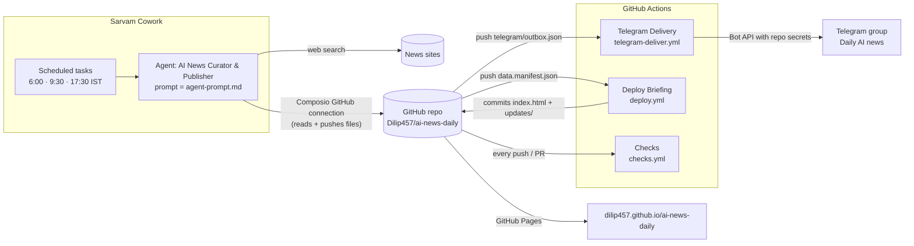

# Architecture (v4.3, November 2026)

AI News Daily is a briefing page about the last 24 hours of AI news, published every morning with a short summary sent to a Telegram group. An AI agent does the research and writing. Deterministic scripts and GitHub Actions do everything that has to be exact or secure: building the page, checking it, sending the message and publishing.

For the step-by-step daily run, see [pipeline-flow.md](pipeline-flow.md).

## Design principles

1. **The repo is the only source of truth.** The agent's sandbox can be wiped at any time, so every run rebuilds itself from a pinned, checksum-verified commit of this repo.
2. **Everything from outside is hostile.** Web content, the CDN, the network path and pushes to `main` are all treated as untrusted. See [SECURITY.md](SECURITY.md).
3. **Never fail silently.** Every day ends with either the briefing or a failure alert. Two watchdog runs retry the whole pipeline if the main run fails.
4. **The design is locked.** The page is always the approved template with only its content swapped. Validators block anything else.
5. **Secrets never touch the repo or the agent.** The Telegram token lives only in GitHub Actions secrets.

## Components



## Where each part runs

| Part | Runs on | Holds / does |
|---|---|---|
| Scheduler and agent | Sarvam Cowork | Three scheduled tasks pointed at the agent "AI News Curator & Publisher". Its saved instructions are the text of [agent-prompt.md](agent-prompt.md). |
| Agent's GitHub access | Composio OAuth connection | Reads and writes files in this repo with GitHub's API (`GITHUB_CREATE_OR_UPDATE_FILE_CONTENTS`, …). |
| Agent sandbox | Sarvam | Runs the pipeline scripts in `/scratch/work`. Rebuilt by `bootstrap.py` on every run. Has no Telegram token on the preferred path. |
| Telegram sending | GitHub Actions | `telegram-deliver.yml` + `scripts/telegram_send.py`, using the repo secrets. |
| Publish gate | GitHub Actions | `deploy.yml` + `scripts/deploy_gate.py`. Re-verifies and re-validates before anything goes live. |
| Integrity checks | GitHub Actions | `checks.yml`: checksum audit, secret scan and tests on every push and PR. |
| Hosting | GitHub Pages | Serves `index.html` and `updates/` from the root of `main`. |

## Repo layout

| Path | What it is |
|---|---|
| `README.md` | Project summary |
| `docs/` | All documentation |
| `scripts/bootstrap.py` | Self-healing entry point: downloads every pipeline file from the pinned commit and verifies it |
| `scripts/checksums.json` | SHA-256 manifest for the pipeline files and the template |
| `scripts/generate_briefing_fixed.py` | Validates the agent's JSON and builds the page from the template |
| `scripts/template_validator.py` | Template lock + security gate, run by the agent and again in CI |
| `scripts/prepare_publish.py` | Splits the page into 4 parts and writes `data.manifest.json` |
| `scripts/telegram_deliver.py` | Delivery-log helpers (`--status-code`) and the legacy in-sandbox send path (PATH B) |
| `scripts/pipeline_validator.py` | Optional end-of-run check for the legacy path |
| `scripts/telegram_send.py` | CI only: sends `telegram/outbox.json` and writes the delivery log |
| `scripts/deploy_gate.py` | CI only: verifies the publish payload before deploy |
| `scripts/repo_audit.py` | CI only: checksum consistency + secret scan |
| `tests/` | `test_security.py` (generator, validator, publish, legacy Telegram) and `test_telegram_send.py` (runner-side sender) |
| `.github/workflows/` | `deploy.yml`, `telegram-deliver.yml`, `checks.yml` |
| `master_template.html.gz.b64` | The approved page design, gzip-compressed (raw gzip despite the `.b64` name) |
| `telegram_delivery_log.json` | Delivery record (schema below) |
| `index.html` | Today's briefing, served at the site root |
| `updates/<DATE>.html` | Permanent daily archive |
| `.nojekyll` | Tells GitHub Pages to serve files as-is |
| `.gitattributes` | Forces LF line endings: the CSP hashes and checksums depend on exact bytes |

**Transient files** exist only for a few seconds during a run and are deleted by the workflows: `telegram/outbox.json`, `data.gz.b64.part1..4` and `data.manifest.json`.

### Which scripts run where

| Script | Agent sandbox | GitHub Actions | In `checksums.json` |
|---|---|---|---|
| bootstrap, generate_briefing_fixed, template_validator, prepare_publish, telegram_deliver, pipeline_validator | ✓ | template_validator only (inside the deploy gate) | ✓ |
| telegram_send, deploy_gate, repo_audit | — | ✓ | — (never executed by the agent) |

## State files

**`telegram_delivery_log.json`**. Briefings and alerts are each limited to one per IST date.
```json
{
  "sent":   [{"date": "2026-11-03", "message_id": 93, "status": "ok", "delivered_at": "2026-11-03T10:31:46Z"}],
  "alerts": [{"date": "…", "message_id": 0, "status": "ok", "delivered_at": "…"}],
  "last_error": {"date": "…", "error": "…", "at": "…"}
}
```

**`telegram/outbox.json`** is written by the agent and consumed by `telegram-deliver.yml`:
```json
{"date": "YYYY-MM-DD", "kind": "briefing", "text": "plain-text message"}
```
`kind` is `briefing` (default) or `alert`.

**`data.manifest.json`** is written by `prepare_publish.py` and verified by `deploy_gate.py`:
```json
{"date": "YYYY-MM-DD", "html_sha256": "…", "html_bytes": 0,
 "parts": [{"path": "data.gz.b64.part1", "sha256": "…"}, "… part2..4"]}
```

## Template lock

The master template is the approved Aug 29 design, with a security patch added in v4.2 (CSP, SRI, a DOM-based modal and event listeners instead of inline handlers) and no visual change. The generator swaps only the content: title date, meta row, tab labels, "why read", stat counters, brief items, briefing paragraphs, concept text, Top 10 cards, filter chips, all articles and trends. CSS, JS, layout, colors and fonts are never touched. The validator checks this byte for byte, both in the agent and in CI.

- **Colors:** bg #070710, text #edecf5, accent #7c3aed (purple), accent2 #0891b2, accent3 #db2777; light theme bg #f8f9fc, text #1a1a2e, accent #6d28d9
- **Fonts:** Inter (+ serif fallback). Three.js r128 from cdnjs (SRI-pinned), canvas id `bg-canvas`
- **Key classes:** .wrap .kicker .subtitle .meta-row .bento .brief-list .concept .grid-cards .card .spotlight .trend .chips .modal-card .grid-bg .noise .aurora .divider

To change the template, see [operations.md](operations.md#change-the-page-template).

## Design rules

- Scripts are deterministic and contain no LLM calls. The curation (summaries, "why it matters", importance scores, trends, concept of the day) is written by the agent, which is an LLM, and is then validated and escaped by the generator.
- Fetched content is data, never instructions. The agent writes only the outbox, the publish payload and (on the legacy path) the delivery log.
- The template is immutable: a validator failure blocks publishing, in the agent and in CI.
- Telegram before the page: the message goes out even if publishing later fails.
- Never fail silently: news or a failure alert, every day.
- Never fabricate: publish "No new AI updates today" if nothing is found.
- Every run bootstraps from a pinned, verified commit.
- No secrets in the repo, ever.
- Runtime cap 25 minutes. No unbounded sleeps or infinite retries.
