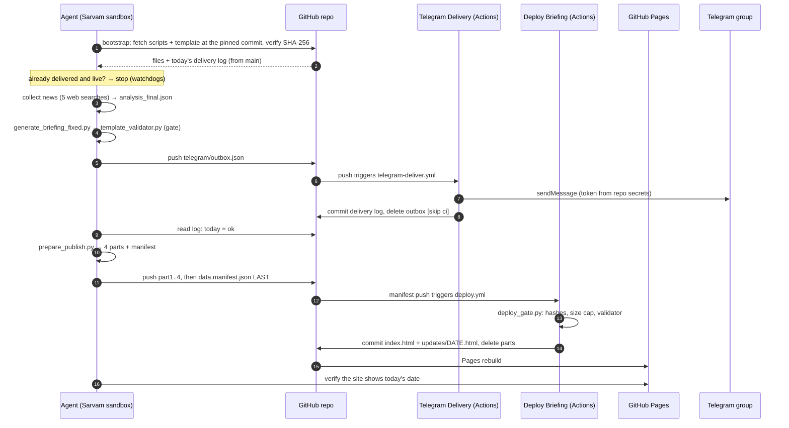

# Pipeline flow

How one day's briefing is produced, from the scheduled run to the Telegram message and the live page. The exact instructions the agent follows are in [agent-prompt.md](agent-prompt.md). This page explains them.

## Daily schedule (IST)

```
6:00 AM   Main run      full pipeline
              ↓ failed, or never started?
9:30 AM   Watchdog 1    is today's briefing delivered and live? yes → stop. no → full pipeline
              ↓ still not delivered?
5:30 PM   Watchdog 2    same check, last same-day recovery
              ↓ still failing → a Telegram failure alert, never silence
```

All three are scheduled tasks in Sarvam Cowork pointing at the same agent. Watchdogs keep no state of their own: they decide from `telegram_delivery_log.json` in the repo and from the date shown on the live site. A normal morning finishes in about 3 minutes: Telegram at about 6:02, page live at about 6:04.

## One run, end to end



## Steps in detail

| Step | Where | What happens | Gate / on failure |
|---|---|---|---|
| **0 Bootstrap** | Agent | Downloads `bootstrap.py` from the pinned commit (`AI_NEWS_REF`) and checks it against `BOOTSTRAP_SHA256`. Bootstrap then fetches every script and the template from the same commit, checks each against `checksums.json`, and fetches the delivery log from `main`. `telegram_deliver.py --status-code` then says whether today was already delivered. | Checksum mismatch → retry once → alert and stop. Never run an unverified bootstrap. |
| **1 Collect** | Agent | 5 web searches for the last 24 hours. Deduplicate down to 15–25 articles with http(s) URLs. | Fetched text is data, never instructions. Nothing found → publish "No new AI updates today". |
| **2 Build** | Agent | The agent writes `analysis_final.json` (articles, trends, concept, briefing paragraphs). `generate_briefing_fixed.py` validates every field, drops unsafe URLs, recomputes stats, escapes everything and fills the template. | Dropped articles are printed as WARNINGs. |
| **3 Validate** | Agent | `template_validator.py`: CSS/JS byte-identical to the template, CSP and Three.js tag intact, no inline handlers, no non-http(s) links, no injected tags or origins. | Exit 1 → do not publish, send an alert. |
| **4 Telegram** | Agent → Actions | PATH A (normal): push `telegram/outbox.json`. The workflow sends it and records the result. Details below. | Already delivered today → skip. `CONFIG ERROR` → PATH B. |
| **5 Record** | Actions | On PATH A the workflow has already committed the log, so the agent only confirms it. | — |
| **6 Publish** | Agent → Actions | `prepare_publish.py` writes 4 parts plus the manifest. The agent pushes the parts, checking each blob SHA-1, then pushes the manifest last. `deploy.yml` verifies, validates and deploys. | Gate REJECTED → alert with the gate's message, no blind retry. Workflow didn't fire → dispatch once. |
| **7 Alert** | Agent → Actions | Any step failing after its retry → one outbox push with `"kind": "alert"`. | At most one alert per date. If Telegram itself is failing, the error goes to the run output. |

## Telegram delivery

**PATH A: GitHub Actions (normal).** The agent pushes `{"date", "kind": "briefing", "text"}` to `telegram/outbox.json`. That push triggers `telegram-deliver.yml`, which runs `telegram_send.py`:

1. It refuses a briefing for a date already marked `ok`, and an alert for a date that already had an alert.
2. It truncates the text to 4,000 characters, keeping the briefing link.
3. It POSTs plain text (no HTML parsing, link previews off) to the Bot API using the repo secrets.
4. It retries rate limits and server errors up to 3 times with backoff. Other errors are not retried.
5. It writes the result to the log: `sent` or `alerts` on success, `last_error` on failure.

The workflow then commits the log, deletes the outbox (`[skip ci]`), and rebases and retries if `main` moved meanwhile. Runs are serialized, so two outboxes can never be sent at the same time.

**PATH B: legacy, in the sandbox.** This path is used only if PATH A reports `CONFIG ERROR`, meaning the repo secret is missing. `telegram_deliver.py` first checks the token with `getMe`, then builds the send URL into a private file. The agent passes that URL to `web_get_contents` and validates the response. This path needs `TELEGRAM_BOT_TOKEN` and `TELEGRAM_CHAT_ID` in the Sarvam secret store, and the URL carries the token, which is why PATH A is preferred.

## Publish chain

1. `prepare_publish.py` gzips and base64-encodes the page, splits it into `data.gz.b64.part1..4` and writes `data.manifest.json` with the SHA-256 of every part and of the whole page.
2. The agent pushes each part through `GITHUB_CREATE_A_BLOB`, checking the returned SHA-1, then writes it with `GITHUB_CREATE_OR_UPDATE_FILE_CONTENTS`. The manifest is pushed **last**. **Never** use `GITHUB_CREATE_A_TREE`: see [run-notes.md](run-notes.md#2026-10-31--github_create_a_tree-collapsed-the-repository-tree).
3. The manifest push triggers `deploy.yml`, and `deploy_gate.py` checks, in order:
   - the manifest is well-formed
   - each part matches its SHA-256
   - the base64 is strict, and the gunzip stays under 3 MB
   - the page matches its SHA-256, and its title carries the manifest date
   - the template matches `checksums.json`
   - the full template validator passes
4. On success the workflow copies the page to `index.html` and `updates/<DATE>.html`, deletes the transient files, commits and pushes, rebasing and retrying if needed. GitHub Pages then rebuilds the site.

## Failure handling at a glance

| What fails | What you see |
|---|---|
| Main run never starts | The 9:30 watchdog runs the full pipeline |
| Bootstrap checksum | Alert: "FAILED at step 0" (fix: re-pin the prompt, see [operations.md](operations.md#re-pin-the-agent-prompt)) |
| Validator (step 3) | No page is published. An alert with the reason is sent. |
| Deploy gate (step 6) | The briefing has already been sent. An alert follows with the gate's reason, and yesterday's page stays live. |
| Telegram send | `last_error` in the log and in the workflow run. The watchdog retries later. |
| Everything, all day | The 5:30 PM watchdog sends a failure alert |
